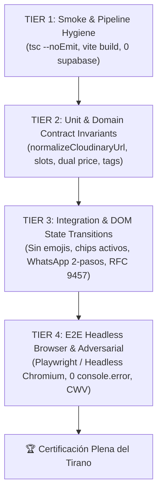

# Estado del Pipeline de Compilación, Tipado e Infraestructura de Pruebas
**Proyecto:** Restaurante Sabe a Perú  
**Documento:** `pipeline_state.md`  
**Fecha de Inspección:** 2026-10-09  
**Explorador Responsable:** Pipeline Explorer (`teamwork_preview_explorer_survey_pipeline`)  
**Metodología:** Spec-Driven Development (SDD) & Zero-Trust Architecture  

---

## 1. Resumen Ejecutivo

Se ha realizado una auditoría forense exhaustiva del pipeline de compilación, comprobación estática de tipos, empaquetado y entorno de testing del proyecto **Sabe a Perú**.

### Hallazgos Principales:
1. **Estado Actual de Ejecución:** El script oficial `npm run pipeline` (definido como `tsc --noEmit && vite build`) termina actualmente con **Exit Code 0** en aproximadamente 900 ms.
2. **Deuda de Tipado Enmascarada (`: any`):** Aunque `tsc --noEmit` no reporta errores de compilación debido a la permisividad de anotaciones explícitas de tipo `any`, se han localizado **22 instancias de `: any`** distribuidas en `src/admin.ts` (13), `src/main.ts` (8) y `src/experiencia.ts` (1). Bajo las reglas inmutables del Tirano y el contrato SDD ("Si hay evasiones/any/@ts-ignore -> VETO"), este código está en riesgo de veto si no se tipa con los esquemas de `specs/openapi.yaml`.
3. **Residuos de Supabase en Producción:** `src/supabase.ts` y la dependencia `@supabase/supabase-js@2.104.1` siguen presentes en el proyecto, a pesar de que el código operativo fue migrado a Firebase Firestore y la especificación ([DT-06]) exige su total erradicación.
4. **Ausencia Total de Infraestructura de Pruebas:**
   - Hay **0 archivos de test** en el repositorio.
   - `package.json` **no define ningún script de test** (`"test"` no existe).
   - No hay instalada ninguna librería de testing (ni Vitest, ni Jest, ni `@playwright/test`, ni Puppeteer).
5. **Entorno Node.js Disponible:** El sistema anfitrión cuenta con **Node.js v24.13.1** y **npm 11.8.0**. Node.js 24 cuenta con el test runner nativo (`node:test` y `node:assert`), lo que permite ejecutar suites de pruebas unitarias y de contrato de forma inmediata y sin dependencias externas si fuera necesario.
6. **Configuración Vite MPA:** `vite.config.ts` gestiona 4 puntos de entrada HTML (`index.html`, `carta.html`, `admin.html`, `experiencia.html`), pero carece de la configuración de `manualChunks` exigida formalmente en `specs/performance-spec.md` (Sección 5) para aislar el motor de Firebase y evitar que módulos de administración contaminen las páginas públicas.

---

## 2. Análisis Detallado de `package.json`

### 2.1. Scripts Declarados
```json
"scripts": {
  "dev": "vite",
  "build": "tsc && vite build",
  "preview": "vite preview",
  "pipeline": "tsc --noEmit && vite build"
}
```
* **Observación:** El comando `npm run pipeline` ejecuta en serie `tsc --noEmit` y `vite build`. No incluye ninguna fase de ejecución de pruebas unitarias, de integración ni E2E.
* **Carencia:** Falta un script `test` y scripts granulares para el testing track (por ejemplo, `test:unit`, `test:contract`, `test:e2e`).

### 2.2. Dependencias de Producción (`dependencies`)
| Paquete | Versión | Estado / Rol en Arquitectura | Dictamen SDD |
| :--- | :--- | :--- | :--- |
| `@supabase/supabase-js` | `^2.104.1` | **Deuda Técnica [DT-06]**. Ningún archivo en `src/` importa de forma activa este cliente; es huérfano. | **ELIMINAR** de `dependencies` y borrar `src/supabase.ts`. |
| `firebase` | `^12.12.1` | Motor principal de datos (Firestore) y autenticación (Auth). | **MANTENER**. Configurar chunking. |
| `axios` | `^1.14.0` | Cliente HTTP auxiliar. | **REVISAR** si es redundante frente a `fetch` nativo. |
| `csv-parser` | `^3.2.0` | Utilidad de scripts de migración y seeding. | Mover a `devDependencies` o mantener aislado. |
| `lucide-static` | `^0.564.0` | Iconografía SVG. | Conforme con la interfaz. |
| `qrcode` | `^1.5.4` | Generador de códigos QR para mesas/reservas. | Conforme. |
| `sharp` | `^0.34.5` | Procesador de imágenes nativo para scripts de conversión. | Mover a `devDependencies` (no debe importarse en bundle web). |

### 2.3. Dependencias de Desarrollo (`devDependencies`)
| Paquete | Versión | Estado / Rol |
| :--- | :--- | :--- |
| `typescript` | `~5.9.3` | Compilador y typechecker estricto. |
| `vite` | `^7.3.1` | Bundler y dev server con HMR. |
| `@types/node` | `^25.3.0` | Tipos de Node.js. |
| `@types/dom-mediacapture-record` | `^1.0.22` | Tipos para grabación de media en DOM. |

* **Deficiencia Crítica:** Cero frameworks de pruebas instalados. Para cumplir con el *E2E Testing Track* y la especificación de `especialista-qa-navegador`, se requiere incorporar `@playwright/test` o configurar un harness ejecutable con el test runner nativo de Node.js v24.

---

## 3. Análisis de Configuración TypeScript (`tsconfig.json`)

### 3.1. Opciones del Compilador
```json
{
  "compilerOptions": {
    "target": "ES2022",
    "useDefineForClassFields": true,
    "module": "ESNext",
    "lib": ["ES2022", "DOM", "DOM.Iterable"],
    "types": ["vite/client"],
    "skipLibCheck": true,
    "moduleResolution": "bundler",
    "allowImportingTsExtensions": true,
    "verbatimModuleSyntax": true,
    "moduleDetection": "force",
    "noEmit": true,
    "strict": true,
    "noUnusedLocals": true,
    "noUnusedParameters": true,
    "erasableSyntaxOnly": true,
    "noFallthroughCasesInSwitch": true,
    "noUncheckedSideEffectImports": true
  },
  "include": ["src"]
}
```

### 3.2. Hallazgos y Riesgos Arquitectónicos
1. **Alcance de Verificación (`"include": ["src"]`):**
   - El compilador `tsc` **solo analiza los ficheros dentro de `src/`**.
   - Si se añade un directorio `tests/` en la raíz del proyecto, `npx tsc --noEmit` **no lo revisará** a menos que se amplíe `include: ["src", "tests"]` o se añada una configuración de pruebas (`tsconfig.test.json`).
2. **Bandera `allowImportingTsExtensions: true` y `noEmit: true`:**
   - Permite importar con extensión `.ts` explícita. Obliga a que `noEmit: true` esté activo (la emisión de bundles corresponde enteramente a Vite/Rollup).
3. **Cero Tolerancia a `any` (Inquisición SDD vs Configuración Actual):**
   - `strict: true` activa `noImplicitAny: true`, pero **permite tipos `any` explícitos** (ej. `let error: any = null;`).
   - Inventario de evasiones con `: any` detectadas en el código actual:
     - `src/experiencia.ts:21`: `filter((item: any) => ...)`
     - `src/admin.ts:82`: `let error: any = null;`
     - `src/admin.ts:146`: `let allMenuItems: any[] = [];`
     - `src/admin.ts:151`: `let data: any[] = [];`
     - `src/admin.ts:152`: `let error: any = null;`
     - `src/admin.ts:191`: `renderMenuTable(items: any[])`
     - `src/admin.ts:276`: `catch(uploadError: any)`
     - `src/admin.ts:286`: `openEditModal(id: string | null, item: any)`
     - `src/admin.ts:349`: `let error: any = null;`
     - `src/admin.ts:374`: `let error: any = null;`
     - `src/admin.ts:387`: `let data: any[] = []; let error: any = null;`
     - `src/admin.ts:458`: `catch (err: any)`
     - `src/admin.ts:494`: `let data: any[] = []; let error: any = null; filter((item: any) => ...)`
     - `src/admin.ts:537`: `let data: any[] = []; let error: any = null;`
     - `src/admin.ts:544-545`: `filter((file: any) => ...) sort((a: any, b: any) => ...)`
     - `src/admin.ts:593`: `let error: any = null;`
     - `src/admin.ts:635`: `let data: any[] = []; let error: any = null;`
     - `src/admin.ts:644`: `(data || []).forEach((res: any) => ...)`
     - `src/main.ts:219`: `data = data.filter((d: any) => ...)`
     - `src/main.ts:222`: `data.sort((a: any, b: any) => ...)`
     - `src/main.ts:233-234`: `const groups: { [key: string]: any[] } = {}; data.forEach((item: any) => ...)`
     - `src/main.ts:266`: `groups[sub].map((item: any) => ...)`
     - `src/main.ts:385`: `let galleryFiles: any[] = [];`
     - `src/main.ts:410-411`: `filter((file: any) => ...) sort((a: any, b: any) => ...)`
   - **Acción Obligatoria:** Reemplazar todas estas declaraciones por interfaces tipadas (`MenuItemOutput`, `ReservationOutput`, `GalleryItem`, `SiteContentItem`) generadas a partir de `specs/openapi.yaml`.

---

## 4. Análisis de Configuración y Empaquetado Vite (`vite.config.ts`)

### 4.1. Configuración Actual
```typescript
import { defineConfig } from 'vite';
import { resolve } from 'path';

export default defineConfig({
    build: {
        rollupOptions: {
            input: {
                main: resolve(__dirname, 'index.html'),
                carta: resolve(__dirname, 'carta.html'),
                admin: resolve(__dirname, 'admin.html'),
                experiencia: resolve(__dirname, 'experiencia.html')
            }
        }
    }
});
```

### 4.2. Salida de Compilación Observada (`dist/`)
Al ejecutar `npm run pipeline`, la salida de Rollup genera los siguientes artefactos:

| Archivo Generado | Tamaño Bruto | Tamaño Gzip | Propósito |
| :--- | :--- | :--- | :--- |
| `dist/index.html` | 22.87 kB | 5.47 kB | Home pública |
| `dist/carta.html` | 8.35 kB | 2.36 kB | Menú gastronómico |
| `dist/admin.html` | 31.36 kB | 5.15 kB | Panel de administración |
| `dist/experiencia.html` | 16.19 kB | 4.10 kB | Historia y filosofía |
| `dist/assets/style-C5TgX9lU.css` | 26.70 kB | 6.51 kB | CSS global |
| `dist/assets/experiencia-B0fP9rJR.css` | 6.32 kB | 2.01 kB | CSS específico de experiencia |
| `dist/assets/main-Aa1hZj4t.js` | 15.82 kB | 6.21 kB | Lógica de Home y carta |
| `dist/assets/admin-ClVik-LY.js` | 13.30 kB | 4.49 kB | Lógica del panel backoffice |
| `dist/assets/reservations-DD61N7zP.js` | 2.10 kB | 1.04 kB | Módulo compartido de disponibilidad |
| `dist/assets/experiencia-DbECqGMU.js` | 4.29 kB | 1.98 kB | Lógica de experiencia |
| `dist/assets/firebase-BC8am6bB.js` | **376.09 kB** | **116.81 kB** | SDK de Firebase común |

### 4.3. Brechas contra la Especificación (`specs/performance-spec.md`)
1. **Falta de `manualChunks`:** `specs/performance-spec.md` Sección 5 establece:
   > *"En `vite.config.ts`, se debe configurar `manualChunks` para desacoplar el motor de Firebase del código de la aplicación. La carga de módulos pesados de administración (como el cliente de subida de imágenes o SDKs de autenticación) no debe contaminar el bundle de las páginas públicas (`index.html`, `carta.html`)."*
2. **Peso del Bundle de Firebase:** El bundle de Firebase ocupa 376 kB sin comprimir (116 kB gzip). Aunque Rollup lo ha separado en un chunk independiente, se cargan juntos Firestore, Auth, Storage y Analytics incluso en páginas públicas que solo requieren lectura de Firestore.
3. **Módulo `counter.ts` Huérfano:** Existe un fichero `src/counter.ts` residual del template inicial de Vite que no se usa en ningún lugar.

---

## 5. Estado Actual del Pipeline y Verificación en Vivo

### 5.1. Ejecución de `npm run pipeline`
Comando ejecutado: `npm run pipeline` en `c:\Users\Martin\Documents\Trabajo\sabeaperu`
```
> sabeaperu@0.0.0 pipeline
> tsc --noEmit && vite build

vite v7.3.1 building client environment for production...
transforming...
✓ 34 modules transformed.
rendering chunks...
computing gzip size...
dist/carta.html                         8.35 kB │ gzip:   2.36 kB
dist/experiencia.html                  16.19 kB │ gzip:   4.10 kB
dist/index.html                        22.87 kB │ gzip:   5.47 kB
dist/admin.html                        31.36 kB │ gzip:   5.15 kB
dist/assets/experiencia-B0fP9rJR.css    6.32 kB │ gzip:   2.01 kB
dist/assets/style-C5TgX9lU.css         26.70 kB │ gzip:   6.51 kB
dist/assets/reservations-DD61N7zP.js    2.10 kB │ gzip:   1.04 kB
dist/assets/experiencia-DbECqGMU.js     4.29 kB │ gzip:   1.98 kB
dist/assets/admin-ClVik-LY.js          13.30 kB │ gzip:   4.49 kB
dist/assets/main-Aa1hZj4t.js           15.82 kB │ gzip:   6.21 kB
dist/assets/firebase-BC8am6bB.js      376.09 kB │ gzip: 116.81 kB
✓ built in 903ms
```
* **Exit code:** `0` (Exitoso)
* **Duración:** 903 ms

### 5.2. Ejecución de `npx tsc --noEmit`
Comando ejecutado de forma aislada: `npx tsc --noEmit`
* **Exit code:** `0` (0 errores de compilación)

### 5.3. Anomalías y Trampas Ocultas Detectadas
A pesar de que el pipeline pasa en verde:
1. **Doble Renderizado Activo en `index.html`:** En las líneas 216 a 261 de `index.html` existen 10 etiquetas `` con fuentes duras hacia Supabase (`https://xdslypbjmenthwyrarui.supabase.co/...`). Al cargar la página, el navegador inicia la descarga de estas 10 imágenes. Inmediatamente después, `src/main.ts` ejecuta `galleryGrid.innerHTML = ''` y descarga los elementos desde Firestore/Storage, duplicando peticiones de red y destruyendo el presupuesto LCP/FCP.
2. **Bloqueo del Hilo Principal por `@import` en `src/style.css`:** La línea 1 de `src/style.css` contiene un `@import url(...)` que carga de manera síncrona 8 familias tipográficas completas de Google Fonts, retrasando críticamente el renderizado de la primera pantalla.
3. **Bloqueo Asíncrono de Popups de WhatsApp:** En `src/main.ts` (línea 611), `window.open(waUrl, '_blank')` se ejecuta después de `await addDoc(...)`. Los navegadores modernos en iOS y Android bloquean sistemáticamente esta apertura por pérdida del gesto de usuario activo.
4. **Desconexión Arquitectónica en Galería:** `src/admin.ts` sube imágenes a Cloudinary (`api.cloudinary.com`) pero intenta leerlas y borrarlas desde Firebase Storage (`restaurante-assets/`).

---

## 6. Estado de la Infraestructura de Pruebas

### 6.1. Inventario Actual
* **Ficheros de prueba (`*.test.ts`, `*.spec.ts`, `tests/`):** **0 encontrados.**
* **Configuración de testing en `package.json`:** No existe script `"test"`.
* **Herramientas de testing en `node_modules`:** Ni Vitest, ni Jest, ni Playwright están instalados.

### 6.2. Capacidades Nativas del Entorno
* **Node.js v24.13.1:** Cuenta con un módulo de testing nativo con soporte completo para aserciones estrictas (`node:assert/strict`), ejecución de suites (`node:test`), mocks (`mock` de `node:test`) y cobertura.
* Se pueden ejecutar pruebas unitarias y de contrato directamente mediante:
  `node --test` o `node --test tests/**/*.test.js / tests/**/*.test.mjs`
  sin requerir descargas pesadas de npm ni alterar dependencias externas si se desea máxima agilidad.

---

## 7. Diseño Arquitectónico del E2E Testing Track (Tiers 1-4)

Para garantizar que cada una de las 6 fases de remediación de deuda técnica ([DT-01] a [DT-13]) no degrade el sistema y supere la auditoría forense del Tirano, se estructura la pista de pruebas en **4 Tiers incrementales**:



---

### Tier 1: Smoke, Compilación y Limpieza Estática (Pipeline Hygiene)
* **Objetivo:** Verificar la integridad estructural y la ausencia de residuos no autorizados antes de cualquier ejecución.
* **Comandos y Chequeos:**
  1. `npx tsc --noEmit` -> Exit code 0, 0 diagnósticos.
  2. `npx vite build` -> Exit code 0, generación de `dist/` con los 4 HTMLs (`index.html`, `carta.html`, `admin.html`, `experiencia.html`).
  3. **Verificación Estática de Supabase:** Script de escaneo de código para asegurar:
     - 0 apariciones de `@supabase/supabase-js` en `package.json`.
     - Inexistencia física de `src/supabase.ts`.
     - 0 imports hacia `supabase` en todo `src/`.
  4. **Verificación de Tipos Strict:** Cero uso de `any` explícito y cero directivas `@ts-ignore` / `@ts-nocheck` en código de producción.

---

### Tier 2: Invariantes Unitarias y de Contratos de Dominio (Pure Functions & Logic)
* **Objetivo:** Blindar la lógica de negocio pura y funciones utilitarias sin depender de la red o del navegador.
* **Casos de Prueba Específicos:**
  1. **Normalizador de URLs Cloudinary (`normalizeCloudinaryUrl`):**
     - Transforma URL base de Cloudinary inyectando `f_auto,q_auto,w_800,c_limit`.
     - **Idempotencia:** Si se pasa una URL ya transformada (`.../f_auto,q_auto,w_800,c_limit/...`), no duplica los flags.
     - **Limpieza de query string:** Erradica parámetros `?v=123` o `?foo=bar`.
     - **Resiliencia:** Si la URL es local o no contiene `cloudinary.com`, la retorna intacta sin lanzar excepciones.
  2. **Motor de Disponibilidad y Cupos de Reserva (`getAvailableSlots`):**
     - Genera intervalos discretos de exactamente 30 minutos respetando `KITCHEN_HOURS` según el día de la semana.
     - **Invariante de Aforo:** Si hay 4 o más reservas en un slot (`status != 'cancelled'`), `available` debe ser `false` con motivo `"Completo"`.
     - Si hay 0, 1, 2 o 3 reservas, `available` debe ser `true`.
     - Reservas con `status == 'cancelled'` **no restan aforo** para el cómputo.
  3. **Regla de Precios Duales:**
     - Si `price > 0`: retorna string formateado con dos decimales y símbolo euro (ej. `24.50€`).
     - Si `price == 0` o `null`: delega en la descripción o muestra `"Precio según mercado"` sin mostrar `0.00€`.
  4. **Validador de Alérgenos (`AllergenTag`):**
     - Valida estrictamente la lista contra los 16 valores oficiales de `specs/openapi.yaml`.
     - Rechaza o filtra tags extraños o mal formados.

---

### Tier 3: Integración y Transiciones de Estado del DOM (Component & User Journeys)
* **Objetivo:** Comprobar la correcta representación de los componentes visuales y el comportamiento ante eventos de usuario en un entorno DOM simulado o headless.
* **Casos de Prueba Específicos:**
  1. **Renderizado de la Carta Digital (`carta.html` y `index.html`):**
     - **Cero Emojis:** Inspección de los titulares de platos (`<h3>`): prohibida la presencia de emojis (`🐟`, `🥩`, `🍗`, `🌶️`, `🌾`, `📸`).
     - **Micro-etiquetas de Alérgenos:** Los alérgenos deben renderizarse como `<span class="allergen-pill">TAG</span>` tipográficos sobrios.
     - **Trigger Fotográfico:** Presencia del botón/enlace editorial `dish-photo-trigger` con texto `"FOTOGRAFÍA"` en sustitución del botón píldora reflectante.
  2. **Flujo de Conserjería de Reservas:**
     - Bloqueo de fechas pasadas en el selector (`input[type="date"]`).
     - Formulario de dos pasos: tras guardar en Firestore, se renderiza una tarjeta de confirmación en el DOM con localizador único (`SP-XXXX`).
     - Botón de apertura voluntaria de WhatsApp (`<a>` con enlace `https://wa.me/...`), eliminando el `window.open` automático bloqueado.
     - Advertencia ante grupos especiales (> 6 comensales).
     - Mapeo de errores con toasts flotantes en lugar de `window.alert()`.
  3. **Panel de Administración (Backoffice):**
     - Selector visual de alérgenos: renderiza 16 chips interactivos que alternan la clase `.active`.
     - Previsualización instantánea: el input de fichero dispara `URL.createObjectURL` en el evento `change` sin esperar al servidor.
     - Tabla de reservas: renderiza botones de acción operativa (`Confirmar`, `Cancelar`, `WhatsApp Directo`).
     - Galería: opera exclusivamente contra Firestore `gallery_items` (0 llamadas a Firebase Storage).

---

### Tier 4: Pruebas E2E en Navegador Headless y Hardening Adversarial
* **Objetivo:** Ejecución en navegador real (Chromium headless vía Playwright o CLI) simulando dispositivos móviles y de escritorio, verificando SLAs de rendimiento, ausencia de errores de red y consistencia visual.
* **Herramienta Recomendada:** Playwright (`@playwright/test`) o script de ejecución headless con Playwright/Puppeteer contra el servidor de pruebas local (`npx vite preview --port 4173` o `npx vite`).
* **Casos de Prueba Específicos:**
  1. **Auditoría Forense de Consola y Red:**
     - Intercepción de `page.on('console', msg => ...)`: **0 errores `console.error` permitidos**.
     - Intercepción de `page.on('pageerror', err => ...)`: **0 excepciones no capturadas**.
     - Intercepción de peticiones de red: **0 peticiones 404/500**, especialmente 0 peticiones hacia URLs inexistentes o de Supabase.
  2. **Erradicación del Doble Render de Galería:**
     - Inspección del tráfico de red en la carga inicial: **0 descargas de las 10 imágenes de Supabase** en `#main-gallery-grid`.
     - El contenedor `#main-gallery-grid` debe mostrar un skeleton o espacio reservado sin saltos de layout (CLS < 0.1).
  3. **SLAs de Rendimiento y Core Web Vitals:**
     - Imagen LCP del Hero principal: cuenta con `loading="eager"` y `fetchpriority="high"`.
     - Imágenes secundarias: cuentan con `loading="lazy"` y dimensiones explícitas/aspect-ratio.
     - Scroll: no genera advertencias de `"Added non-passive event listener"`. El scroll reveal opera mediante `IntersectionObserver`.
     - Fuentes: verificación en el `<head>` de `<link rel="preconnect">` hacia Google Fonts y ausencia de sentencias `@import` síncronas en CSS.
  4. **Multi-Viewport y Responsive:**
     - Emulación móvil: iPhone 13 (390x844) y Android estándar (375x667).
     - Ausencia de scroll horizontal involuntario (`document.documentElement.scrollWidth <= window.innerWidth`).
     - Altura mínima táctil de botones interactivos (`>= 44px`).
  5. **Pruebas Adversariales (Edge Cases):**
     - Intento de reserva con campos vacíos o email inválido.
     - Intento de selección de fecha pasada manipulando el DOM.
     - Comprobación de fallback de galería local si la conexión al CDN falla (degradación a los 8 activos de `/assets/`).

---

## 8. Recomendaciones Concretas para el Equipo de Implementación

1. **Añadir Scripts de Testing a `package.json`:**
   ```json
   "scripts": {
     "dev": "vite",
     "build": "tsc && vite build",
     "preview": "vite preview",
     "test": "node --test tests/**/*.test.js",
     "test:e2e": "playwright test",
     "pipeline": "tsc --noEmit && vite build"
   }
   ```
2. **Actualizar `vite.config.ts` para Code-Splitting:**
   Configurar `manualChunks` para aislar Firebase:
   ```typescript
   export default defineConfig({
     build: {
       rollupOptions: {
         input: {
           main: resolve(__dirname, 'index.html'),
           carta: resolve(__dirname, 'carta.html'),
           admin: resolve(__dirname, 'admin.html'),
           experiencia: resolve(__dirname, 'experiencia.html')
         },
         output: {
           manualChunks: {
             firebase: ['firebase/app', 'firebase/firestore', 'firebase/auth']
           }
         }
       }
     }
   });
   ```
3. **Erradicar Dependencia de Supabase:**
   - Eliminar `@supabase/supabase-js` de `package.json`.
   - Eliminar el fichero `src/supabase.ts`.
4. **Erradicar Evasiones `: any` en TypeScript:**
   - Crear un archivo de tipos de contrato `src/types/contract.ts` alineado con `specs/openapi.yaml`.
   - Reemplazar todos los `: any` identificados en `src/admin.ts`, `src/main.ts` y `src/experiencia.ts`.
