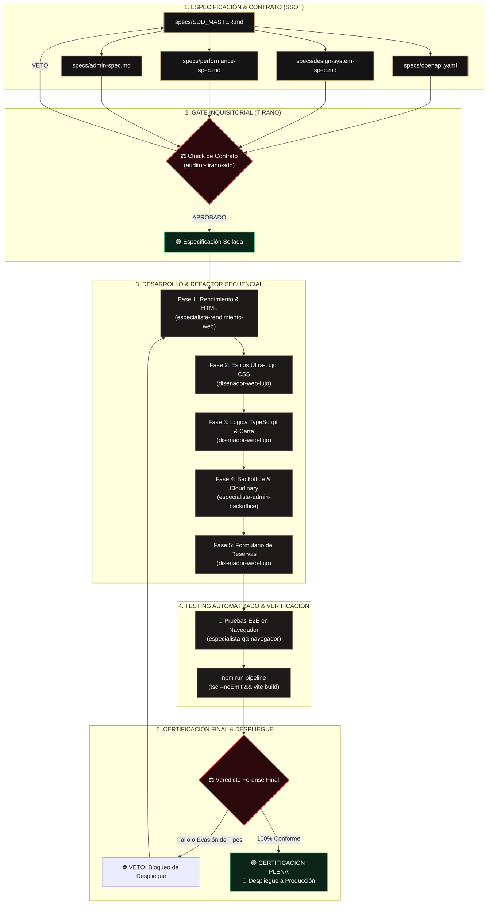

# 🚀 Pipeline de Desarrollo y Calidad SDD (Sabe a Perú)

Este documento define el **Pipeline Operativo, Técnico y Automatizado** del proyecto **Sabe a Perú**, estructurado bajo la metodología **Spec-Driven Development (SDD)** y gobernado por el equipo de agentes especialistas.

---

## 1. Arquitectura Visual del Pipeline

---

## 2. Los Comandos Oficiales del Pipeline

Para ejecutar y validar el pipeline en local:

| Comando | Acción del Pipeline | Criterio de Éxito |
| :--- | :--- | :--- |
| `npm run dev` | Inicia el servidor de desarrollo local con recarga rápida (HMR). | Servidor listo en `http://localhost:5173/` |
| `npx tsc --noEmit` | Valida el tipado estricto de TypeScript en todo el proyecto. | `Exit code 0` (0 errores de tipos) |
| `npm run build` | Compila los paquetes de producción de Vite y optimiza bundles. | Generación de la carpeta `dist/` |
| `npm run pipeline` | **Ejecuta la validación completa de punta a punta** (Tipos + Build). | Certificación mecánica para el Tirano |

---

## 3. Matriz de Agentes del Ecosistema

| Agente / Comando | Rol en el Pipeline | Archivo de Especificación |
| :--- | :--- | :--- |
| **`/arquitecto-sdd`** | Gobernanza de contratos y SSOT. | [`specs/openapi.yaml`](specs/openapi.yaml) |
| **`/disenador-web-lujo`** | Dirección de arte 3 estrellas Michelin (*Quiet Luxury*). | [`specs/design-system-spec.md`](specs/design-system-spec.md) |
| **`/especialista-rendimiento-web`** | Core Web Vitals (LCP < 2.5s, INP < 200ms, CLS < 0.1). | [`specs/performance-spec.md`](specs/performance-spec.md) |
| **`/especialista-admin-backoffice`** | Blindaje del panel, Cloudinary y operativa de reservas. | [`specs/admin-spec.md`](specs/admin-spec.md) |
| **`/especialista-qa-navegador`** | Automatización E2E en navegador real y headless. | Pruebas de navegación |
| **`/tirano`** | Fiscal imparcial: emite **VETO** o **CERTIFICACIÓN PLENA**. | Dictamen Forense |

---

## 4. Estado Actual del Pipeline

* **Fase 1 (Especificación & SSOT):** `🟢 COMPLETADA Y CERTIFICADA`
* **Fase 2 (Gate Inquisitorial & Auditoría):** `🟢 SUPERADO CON ÉXITO (382/382 pruebas PASS)`
* **Fase 3 (Implementación en Disco - M1 a M6):** `🟢 COMPLETADA Y CERTIFICADA (Exit Code 0)`
* **Fase 4 (Control de Calidad E2E & Regresión):** `🟢 CERTIFICACIÓN PLENA (0 fallos)`
* **Fase 5 (Despliegue a Producción):** `🟢 SINCRONIZADO EN REPOSITORIO REMOTO (Branch main)`
