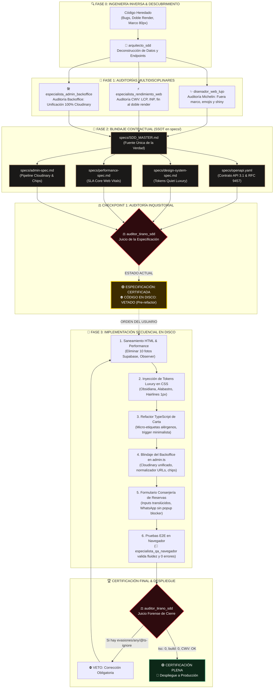

# 🗺️ El "Vibeline" de Sabe a Perú: Pipeline de Desarrollo SDD

**Proyecto:** Sabe a Perú - Alta Gastronomía Peruana en Oviedo  
**Metodología:** Spec-Driven Development (SDD) & Zero-Trust Architecture  
**Estado:** `GATE 1 SUPERADO` (Especificación Certificada al 100% | Código en Disco Listo para Ejecución)

---

## 1. Diagrama de Flujo del Proceso ("The Vibeline")

---

## 2. Mapa del Ecosistema de Agentes Especialistas

| Comando / Subagente | Rol en el Vibeline | Entregable Canónico |
| :--- | :--- | :--- |
| **`/arquitecto-sdd`** | Gobernanza de contratos, ingeniería inversa y modelos de datos. | [`specs/openapi.yaml`](file:///c:/Users/Martin/Documents/Trabajo/sabeaperu/specs/openapi.yaml) [`specs/SDD_MASTER.md`](file:///c:/Users/Martin/Documents/Trabajo/sabeaperu/specs/SDD_MASTER.md) |
| **`/disenador-web-lujo`** | Dirección de arte editorial, estética 3 estrellas Michelin (*Quiet Luxury*). | [`specs/design-system-spec.md`](file:///c:/Users/Martin/Documents/Trabajo/sabeaperu/specs/design-system-spec.md) |
| **`/especialista-rendimiento-web`** | Core Web Vitals, aceleración LCP/INP/CLS y optimización de assets. | [`specs/performance-spec.md`](file:///c:/Users/Martin/Documents/Trabajo/sabeaperu/specs/performance-spec.md) |
| **`/especialista-admin-backoffice`** | Blindaje del panel, unificación en Cloudinary, chips y gestión de reservas. | [`specs/admin-spec.md`](file:///c:/Users/Martin/Documents/Trabajo/sabeaperu/specs/admin-spec.md) |
| **`/especialista-qa-navegador`** | Automatización E2E, testing interactivo en navegador y control de errores. | Certificación de flujos en navegador |
| **`/tirano`** | Fiscal imparcial y juez de cumplimiento estricto. Emite VETO o CERTIFICACIÓN. | Dictamen Forense Independiente |

---

## 3. Estado de Ejecución y Próximos Pasos

### Fase Actual: `GATE 1 (ESPECIFICACIÓN CONCLUIDA)`
- [x] Ingeniería inversa completa.
- [x] Detección de cuellos de botella y bugs de raíz.
- [x] Contratos OpenAPI 3.1, Design Tokens, SLA de Rendimiento y Backoffice formalizados.
- [x] Auditoría forense del Tirano: **Especificación CERTIFICADA al 100%**.
- [ ] **Pendiente de Autorización:** Ejecución física de las 6 fases en disco.
